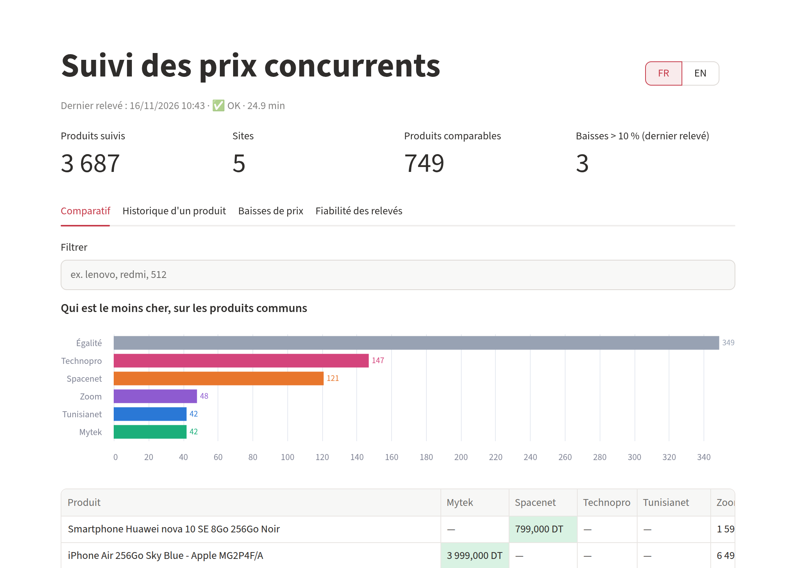
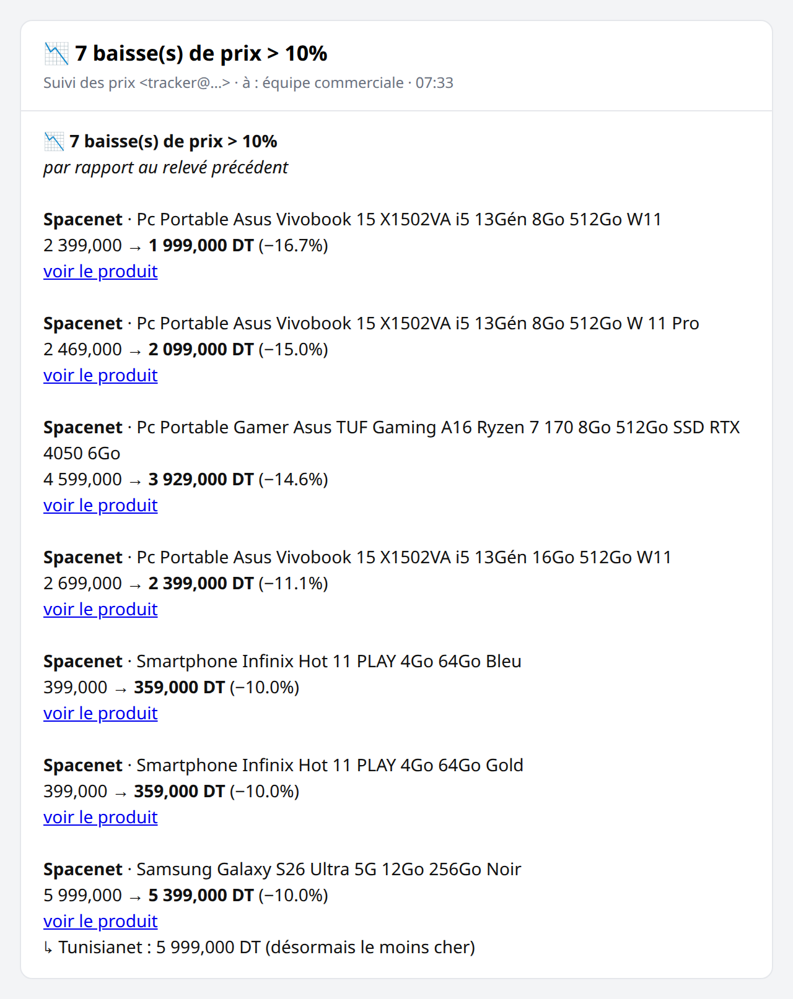
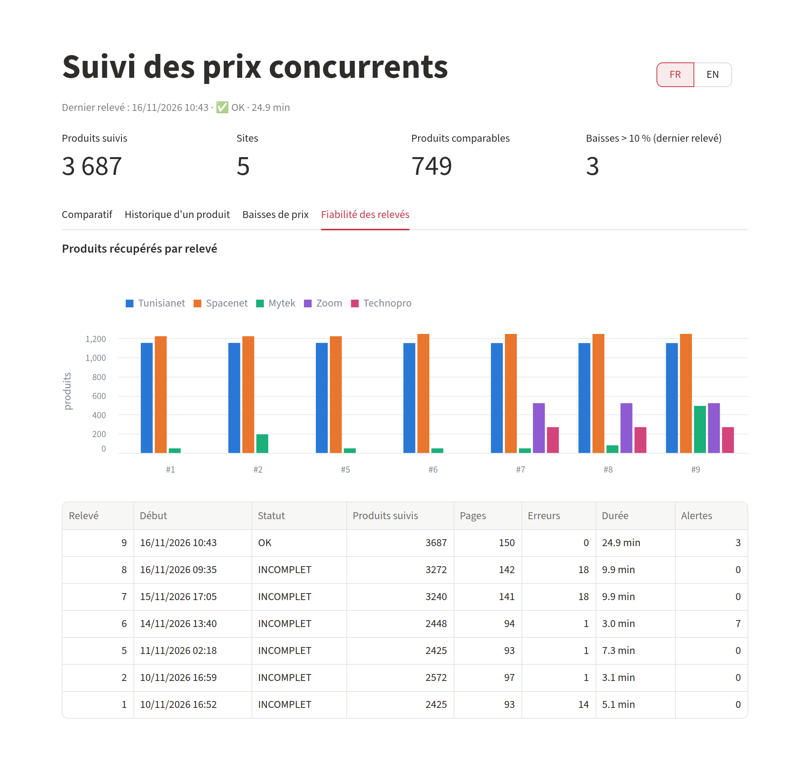
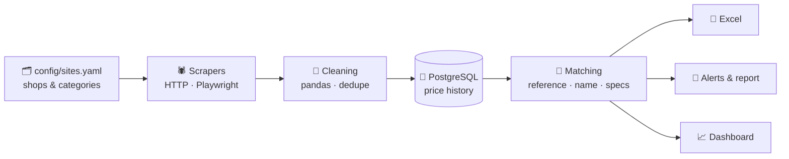

<div align="center">


# Competitor Price Tracker

### Your competitors' prices, in Excel every morning at 8:00.

Every day it reads the public catalogs of five Tunisian electronics shops, finds the same product on<br/>
each site, keeps the full price history and emails you the prices that just dropped.

<br/>

[](https://medamine-sudo.github.io/competitor-price-tracker/)
&nbsp;
[](https://github.com/MedAmine-SUDO/competitor-price-tracker/actions/workflows/tests.yml)


<br/>



</div>

<br/>

## ✨ Why?

A shop that wants to stay competitive has to know what the others charge, every day. Doing it by hand
means opening hundreds of product pages, copying prices into a spreadsheet, and still missing the promo
that started yesterday.

**This tracker does it for you:**

- 🕖 **Every morning, automatically.** A scheduled run reads ~3,700 products from 5 shops, and the report is ready before 8:00.
- 🔗 **The same product, side by side.** "HP 15-fd0438nk i3 8Go 512Go" is found on every shop that sells it, even when each shop names it differently.
- 📉 **Drops come to you.** Any price that falls by more than 10% lands in your inbox, with the competitors' price for context.
- 🤝 **Polite by design.** It follows robots.txt and rate limits, and it stops when a site says stop.

<br/>

## 📊 Real results

Measured on the run of **16 Nov 2026** (laptops + smartphones, 5 shops, 0 errors):

| | |
| --- | --- |
| 🛒 **Products tracked** | **3,687** · Spacenet 1,249 · Tunisianet 1,152 · Zoom 522 · Mytek 494 · Technopro 270 |
| 🔗 **Same product on 2+ shops** | **749**, about half by manufacturer reference, the rest by name + specs |
| 📉 **Price drops caught (> 10 %)** | **10** in the first week (largest −18.1 %), e.g. the Galaxy S26 Ultra went from 5,999 to 5,399 DT on one shop, undercutting the other |
| ⏱️ **Run time** | **4 shops in ~4 minutes**, in parallel; the 5th (Mytek) is paced on purpose at one page every 90 s to respect its limits. Report ready by 07:55 |
| 🧪 **Tests** | **50**, on hand-written HTML (no copies of the sites) |

Zoom and Technopro joined on 15 Nov. Mytek is read slowly on purpose: at 20 s between pages its bot
check stopped every run on the third page; at 90 s all 15 pages go through
(see [Scraping rules](#%EF%B8%8F-scraping-rules)).

<br/>

## 🚀 Features

<table>
<tr>
<td width="50%" valign="top">

### 🕷️ Daily scraping, 5 shops
Tunisianet, Spacenet, Zoom and Technopro over plain HTTP, Mytek through Playwright because its
catalog is rendered by JavaScript. Each shop runs in its own thread.

### 🔗 Cross-site matching
Manufacturer references first, then fuzzy names, with checks that refuse to compare an 8/128 GB phone
with the 8/256 GB one, or two laptops with different model numbers.

### 📗 Excel every morning
A summary, a cross-site comparison with the cheapest price highlighted, today's prices and the day's
drops, in `exports/prix_concurrents_YYYY-MM-DD.xlsx`.

</td>
<td width="50%" valign="top">

### 📧 Email alerts and run report
Price drops above 10% as soon as they're found, plus a daily "run OK" report with the Excel file
attached. Telegram is available as a second channel.

### 📈 Dashboard
Price history per product across shops, who's cheapest, recent drops and run reliability, in French or English.
[Try the demo →](https://medamine-sudo.github.io/competitor-price-tracker/)

### 🛟 Built to run unattended
Retries with backoff, breakage detection when a site changes its HTML, a run report with every
warning, and a scheduler that catches up after the machine was off.

</td>
</tr>
</table>

<table>
<tr>
<td width="44%" valign="top" align="center">
<br/>
<sub>The alert email from a real run</sub>
</td>
<td width="56%" valign="top" align="center">
<br/>
<sub>One product's price, shop by shop</sub>
<br/><br/>
<br/>
<sub>Products collected per run and per shop</sub>
</td>
</tr>
</table>

<br/>

## ⚙️ How it works



Every request goes through one **polite fetch layer**: robots.txt check, per-site delay, retries with
exponential backoff and jitter (honouring `Retry-After`), optional proxy rotation and logging.

<details>
<summary><b>🔗 How the same product is found across shops</b></summary>
<br/>

Shops name products differently ("Pc Portable CHUWI CoreBook / i3-10100Y / 8 Go / 256 Go SSD" vs
"Pc Portable Chuwi CoreBook i3 10Gén 8Go 256Go SSD"), so matching runs in two passes:

1. **Reference code**: the manufacturer part number printed on the card, as an exact match or one code
   extending the other (`82LX00G4FG` / `82LX00G4FG-2Y`).
2. **Fuzzy name** (rapidfuzz), within the same brand and category.

Both passes refuse a match when:

| Check | Example it stops |
| --- | --- |
| RAM, storage, CPU family, colour | 8/128 GB vs 8/256 GB · black vs silver |
| Model tier | Galaxy S26 vs Galaxy S26 **Ultra** |
| Model number in the name | Dell `PV15250` vs `PV15255` · HP `15-fd0438nk` vs `15-fd0580nk` |
| Phone network (fuzzy pass) | Redmi 15C 4G vs 5G |

A model number may extend the other (`X1502VA` / `X1502VA-BQ905W`). Only an identical reference code
overrides the model-number check, because shops do mistype names: one lists the AMD `PV15255` as
"PV15250". A group never holds two listings from the same shop.

</details>

<details>
<summary><b>🛟 Reliability details</b></summary>
<br/>

- **Retries** on timeouts, 429 and 5xx. Permanent errors (403/404) are not retried.
- **End of catalog**: pagination stops when a page has no "next" link, since some shops answer
  HTTP 500 past their last page instead of repeating it.
- **Isolation**: a broken card or a crashed site never stops the others.
- **Breakage detection**: a site returning far fewer products than its recent average marks the run
  `degraded`, and the report says whether it was stopped by a bot check or probably changed its HTML.
- **Logging** to the console and `logs/tracker.log` (rotated daily, 30 days kept). Every run is stored
  in the `runs` table with its full JSON report.

</details>

<br/>

## 🛡️ Scraping rules

| | |
| --- | --- |
| 🌐 **Public pages only** | Category listings. No login, no cart, no personal data. |
| 🤖 **robots.txt, every request** | Checked with a wildcard-aware parser. Mytek forbids any URL with `?`, so its pagination is never requested. `python -m tracker robots` prints the verdict for every configured URL. |
| 🐢 **Rate limits** | 3–90 s between two requests to the same shop (longer if robots.txt asks), and no images or fonts downloaded. |
| ✋ **No bypassing** | If a shop shows a bot check, the run stops that shop for the day and reports it. Coverage grows by adding shops, not by pushing harder. |
| 🔒 **Data stays private** | Scraped prices stay in your database. The public demo runs on generated data, and the tests use hand-written HTML. |

<br/>

## 🧪 The live demo

The [demo](https://medamine-sudo.github.io/competitor-price-tracker/) is the real `dashboard/app.py`,
running entirely in your browser with [stlite](https://github.com/whitphx/stlite) (Streamlit on
WebAssembly), on GitHub Pages. It reads a **generated dataset** with five fictional shops
("Boutique A–E") and three weeks of runs, so no scraped data is republished. Switch between
English and French with the **FR / EN** button. The first load takes about 25 seconds while Python
starts in the browser (charts use Altair, which ships with Streamlit, to keep that short).

<details>
<summary><b>How the demo is built</b></summary>
<br/>

- `dashboard/sources.py` gives the dashboard two interchangeable backends: PostgreSQL, or the demo
  files when `DASHBOARD_DEMO=1`.
- `scripts/make_demo_data.py` generates `dashboard/demo/`: real product models, invented prices,
  promos, price changes and a shop that sometimes stops at a bot check.
- `.github/workflows/pages.yml` copies the app, the data and `site/index.html` and deploys them on
  every push that touches the dashboard.

Run the demo locally: `DASHBOARD_DEMO=1 streamlit run dashboard/app.py`.

</details>

<br/>

## 🏁 Get started

### 🐳 With Docker (server)

```bash
git clone https://github.com/MedAmine-SUDO/competitor-price-tracker.git
cd competitor-price-tracker
cp .env.example .env                      # add your email settings (below)
docker compose up -d --build              # database + daily scheduler + dashboard on :8501
docker compose run --rm scheduler run     # run once now
```

### 💻 Locally

```bash
uv venv .venv && uv pip install -r requirements.txt   # or python -m venv + pip
.venv/bin/playwright install chromium                 # or BROWSER_CHANNEL=chrome to use installed Chrome
docker run -d --name cpt-postgres --restart unless-stopped -p 5433:5432 \
  -e POSTGRES_USER=tracker -e POSTGRES_PASSWORD=tracker -e POSTGRES_DB=pricetracker postgres:16-alpine
cp .env.example .env

.venv/bin/python -m tracker run                  # full run
.venv/bin/python -m tracker run --max-pages 2    # quick test
.venv/bin/streamlit run dashboard/app.py         # dashboard
.venv/bin/pytest                                 # tests
```

Other commands: `init-db`, `export` (rebuild the Excel file from the last run), `test-notify`, `robots`.

<details>
<summary><b>📧 Email setup</b></summary>
<br/>

1. On the sending Gmail account, turn on 2-step verification, then create an app password at
   <https://myaccount.google.com/apppasswords>. Any SMTP server works (port 587 STARTTLS or 465 SSL).
2. In `.env`, set `SMTP_USER` (the address), `SMTP_PASSWORD` (the app password) and `EMAIL_TO`
   (comma-separated recipients).
3. Run `python -m tracker test-notify`.

Telegram works as an extra channel with `TELEGRAM_BOT_TOKEN` and `TELEGRAM_CHAT_ID`. With no channel
configured, messages are written to `logs/notify_preview.txt` so you can see what would be sent.

</details>

<details>
<summary><b>🕖 Scheduling</b></summary>
<br/>

One job a day doesn't need an orchestrator, so the default is the simplest reliable tool:

| Where it runs | Use | Why |
| --- | --- | --- |
| Laptop or workstation | `sh deploy/systemd/install.sh` | systemd timer at 07:30 (Tunis). Unlike cron, it catches up when the machine was off or asleep, and retries a failed run twice. |
| Docker server | `docker compose up -d` | The `scheduler` service runs `deploy/crontab`. |
| Plain server | `deploy/crontab.host` | One cron line. |
| Existing Airflow | `deploy/airflow_dag.py` | When the job has to live next to other pipelines. |

Check the timer with `systemctl --user list-timers` and its logs with `journalctl --user -u price-tracker`.

</details>

<details>
<summary><b>➕ Add a shop or a category</b></summary>
<br/>

- **Category**: add its listing URL to `config/sites.yaml`.
- **Shop**: on PrestaShop it's a handful of CSS selectors (see `tracker/scrapers/zoom.py`); otherwise
  write a `parse_card()` method. Register it in `tracker/scrapers/__init__.py` and add it to the YAML,
  with `engine: browser` if products are rendered by JavaScript.

</details>

<br/>

## 🧰 Tech stack

| Layer | Technology |
| --- | --- |
| Scraping | requests · BeautifulSoup + lxml · Playwright (JS-rendered pages) · Protego (robots.txt) |
| Data | pandas · PostgreSQL 16 · psycopg 3 |
| Matching | rapidfuzz + reference, spec and model-number rules |
| Outputs | openpyxl (Excel) · SMTP email · Telegram Bot API |
| Dashboard | Streamlit · Altair, in French or English; public demo on stlite + GitHub Pages |
| Scheduling | systemd timer · cron in Docker · optional Airflow DAG |
| Quality | pytest (50 tests) · GitHub Actions |

<details>
<summary><b>Project structure</b></summary>
<br/>

```
├── tracker/
│   ├── pipeline.py             # One daily run: scrape → clean → store → match → alert → export
│   ├── fetch.py · browser.py   # Polite fetch layer: robots.txt, delays, retries, proxies
│   ├── scrapers/               # One small parser per shop (PrestaShop ×4, Mytek)
│   ├── parsing.py              # Prices, stock, specs, model numbers
│   ├── cleaning.py             # Validation and dedupe
│   ├── matching.py             # Same product across shops
│   ├── alerts.py · notify.py   # Price drops, email and Telegram
│   └── export.py               # Excel report
├── dashboard/
│   ├── app.py                  # Streamlit dashboard
│   ├── sources.py              # PostgreSQL or demo data
│   └── demo/                   # Generated demo dataset
├── config/sites.yaml           # Shops and categories
├── sql/schema.sql              # Tables and the latest_prices view
├── deploy/                     # systemd timer, crontabs, Docker entrypoint, Airflow DAG
├── scripts/make_demo_data.py
├── site/index.html             # GitHub Pages wrapper (stlite)
└── tests/
```

</details>

<br/>

## 🗺️ Roadmap

- [ ] Rotate Mytek's categories day by day, so its whole catalog is covered over a week
- [ ] More categories: tablets, TVs, accessories
- [ ] Weekly summary email: biggest moves, who's cheapest per brand
- [ ] A review screen to confirm or split doubtful matches

<br/>

<div align="center">

Made with ☕ by [**MedAmine-SUDO**](https://github.com/MedAmine-SUDO)

If this saves you a morning of copying prices, consider giving it a ⭐

</div>
