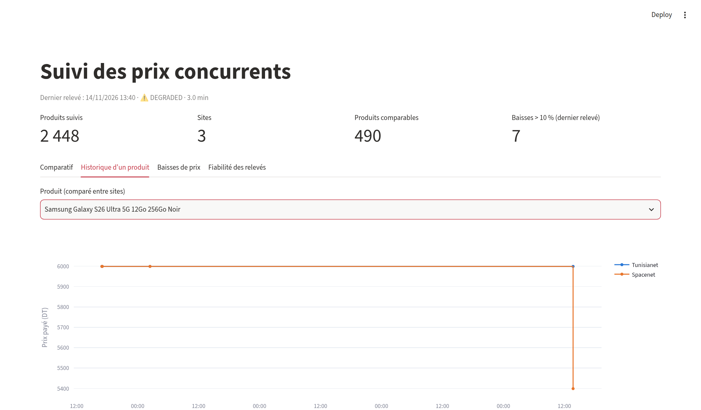

# Suivi automatique des prix concurrents — scraping quotidien vers Excel + alertes email

**Your competitors' prices and stock, in Excel every morning at 8:00, with no manual work.**

Every morning this pipeline reads the public listing pages of three Tunisian electronics shops
(Tunisianet, Spacenet, Mytek). It cleans the data, finds the same product on each site and stores
the full price history in PostgreSQL. Then it delivers:

- an **Excel file** (`exports/prix_concurrents_YYYY-MM-DD.xlsx`) with a summary, a cross-site price
  comparison (cheapest highlighted), today's prices and the day's price drops;
- an **email alert** when a product's price drops by more than 10%, with the competitors' price for context;
- a **Streamlit dashboard** with price-history charts and run reliability;
- a daily **"run OK" report** by email, with the Excel file attached (products per site, pages,
  retries, errors, warnings). Telegram can be added as a second channel.


| Price-drop alert email (real run, 14 Nov 2026) | Price history of one product across sites |
|---|---|
|  |   |

The 14 Nov run caught 7 drops above 10%. One example: Spacenet cut the Galaxy S26 Ultra from 5,999 to
5,399 DT and became cheaper than Tunisianet. The alert says so.

### Measured on a real run (10 Nov 2026, laptops + smartphones)

| | |
|---|---|
| Products tracked | **2,572** (Tunisianet 1,154 · Spacenet 1,223 · Mytek 195) |
| Same product found on 2+ sites | **472** (306 by reference code, 166 by name + specs) |
| Pages read | 97 |
| Run time | **3–5 minutes** |
| Unit tests | 40 |

On those 472 shared products, 303 had the same price everywhere. Spacenet was cheapest on 120,
Tunisianet on 45 and Mytek on 4.

Mytek coverage is limited on purpose. Its robots.txt forbids pagination, and after a handful of page
loads it shows a bot check. The tracker then stops for the day instead of pushing past it (see
[Scraping rules](#scraping-rules-this-project-follows)).

## How it works

```
config/sites.yaml ─▶ scrapers (one thread per site) ─▶ cleaning (pandas) ─▶ PostgreSQL
                       │  HTTP + BeautifulSoup              dedupe, validation   products / price_snapshots
                       │  Playwright for JS-rendered pages                       runs / alerts
                       ▼                                                            │
              polite fetch layer                         matching (reference + fuzzy name + specs)
     robots.txt · per-site delay · retries                                          │
     with backoff · proxy rotation · logging      ┌──────────────┬──────────────────┼─────────────┐
                                                  ▼              ▼                  ▼             ▼
                                             Excel export    Email alerts     Run report    Dashboard
```

| Step | Where |
|---|---|
| Fetch with robots.txt, delays, retries, proxies | `tracker/fetch.py`, `tracker/browser.py` |
| Site parsers (PrestaShop ×2, JS-rendered Mytek) | `tracker/scrapers/` |
| Price / stock / spec parsing | `tracker/parsing.py` |
| Cleaning and dedupe | `tracker/cleaning.py` |
| Cross-site matching | `tracker/matching.py` |
| Storage and price history | `sql/schema.sql`, `tracker/db.py` |
| Price-drop alerts and reports | `tracker/alerts.py`, `tracker/notify.py` (email), `tracker/telegram.py` |
| Excel | `tracker/export.py` |
| Orchestration and run report | `tracker/pipeline.py` |
| Dashboard | `dashboard/app.py` |

### Matching the same product across sites

Shops name products differently ("Pc Portable CHUWI CoreBook / i3-10100Y / 8 Go / 256 Go SSD"
vs "Pc Portable Chuwi CoreBook i3 10Gén 8Go 256Go SSD"), so matching runs in two passes:

1. **Reference code**: the manufacturer part number printed on the card, either an exact match
   or one code extending the other (`82LX00G4FG` / `82LX00G4FG-2Y`).
2. **Fuzzy name** (rapidfuzz), within the same brand and category.

Both passes refuse a match when the specs that separate variants disagree (RAM, storage, CPU
family, colour). The fuzzy pass also never pairs two different part numbers. The result: an 8/128 GB
phone is never compared with the 8/256 GB one, and a black one is never compared with the silver one.

### Reliability

- **Retries** with exponential backoff and jitter on timeouts, 429 and 5xx (honours `Retry-After`).
  Permanent errors (403/404) are not retried.
- **Proxy rotation**: set `PROXY_LIST` and requests rotate through it. Off by default.
- **Isolation**: each site runs in its own thread, and a broken card or a crashed site never stops the others.
- **Breakage detection**: if a site returns far fewer products than its recent average, the run is
  marked `degraded` and the report says so. This is usually the first sign that a site changed its HTML.
- **Logging** to the console and `logs/tracker.log` (rotated daily, 30 days kept). Every run is
  stored in the `runs` table with a full JSON report.

### Scraping rules this project follows

- Only public listing pages; no login, no cart, no personal data.
- **robots.txt is checked before every request**, with a wildcard-aware parser. For example, Mytek
  forbids any URL containing `?`, so Mytek pagination is never requested: only page 1 of each
  category is read, and coverage comes from brand sub-categories instead.
  `python -m tracker robots` prints the verdict for every configured URL.
- At least 3–5 s between two requests to the same site (more if robots.txt asks for it), and
  images/fonts are not downloaded.
- No attempt to bypass bot protection. If a site serves a challenge page, the run reports it and moves on.
- Scraped data stays in your database. **Don't publish it**: show screenshots of the outputs, not a data dump.
  The tests use small hand-written HTML, not copies of the sites.

## Run it

### With Docker (recommended for a server)

```bash
cp .env.example .env          # add your SMTP settings (see Email setup)
docker compose up -d --build  # db + scheduler (07:30 daily) + dashboard on :8501
docker compose run --rm scheduler run   # run once now
```

Excel files land in `./exports`, logs in `./logs`.

### Locally

```bash
uv venv .venv && uv pip install -r requirements.txt   # or python -m venv + pip
.venv/bin/playwright install chromium                 # or set BROWSER_CHANNEL=chrome to use installed Chrome
docker run -d --name cpt-postgres -p 5433:5432 -e POSTGRES_USER=tracker \
  -e POSTGRES_PASSWORD=tracker -e POSTGRES_DB=pricetracker postgres:16-alpine
cp .env.example .env

.venv/bin/python -m tracker run                  # full run
.venv/bin/python -m tracker run --max-pages 2    # quick test
.venv/bin/streamlit run dashboard/app.py         # dashboard
.venv/bin/pytest                                 # tests
```

Other commands: `init-db`, `export` (rebuild the Excel file from the last run), `test-notify`, `robots`.

### Scheduling

One job a day does not need an orchestrator, so the default is the simplest tool that is reliable:

- **Laptop or workstation**: a systemd timer (`sh deploy/systemd/install.sh`). It runs at 07:30
  Africa/Tunis and, unlike cron, catches up as soon as the machine is back if it was off or asleep
  at that time. A failed run is retried twice, 10 minutes apart.
  Check it with `systemctl --user list-timers` and `journalctl --user -u price-tracker`.
- **Docker server**: the `scheduler` service runs `deploy/crontab` (07:30, ready before 8:00).
- **Plain server**: `deploy/crontab.host`.
- **Existing Airflow**: `deploy/airflow_dag.py`, if the job has to live next to other pipelines.

### Email setup

1. On the sending Gmail account, turn on 2-step verification, then create an app password at
   <https://myaccount.google.com/apppasswords>. Any other SMTP server works too (port 587 STARTTLS or 465 SSL).
2. In `.env`, set `SMTP_USER` (the Gmail address), `SMTP_PASSWORD` (the app password) and
   `EMAIL_TO` (comma-separated recipients).
3. Run `python -m tracker test-notify`.

Telegram works as an extra channel: set `TELEGRAM_BOT_TOKEN` and `TELEGRAM_CHAT_ID`
(bot from [@BotFather](https://t.me/BotFather)). With no channel configured, messages are written to
`logs/notify_preview.txt`, so you can see exactly what would be sent.

## Adding a site or a category

- **Category**: add its listing URL to `config/sites.yaml`.
- **Site**: write a scraper with a `parse_card()` method (about 30 lines; see `tracker/scrapers/`),
  register it in `tracker/scrapers/__init__.py` and add it to the YAML. Use `engine: browser` if
  products are rendered by JavaScript.
